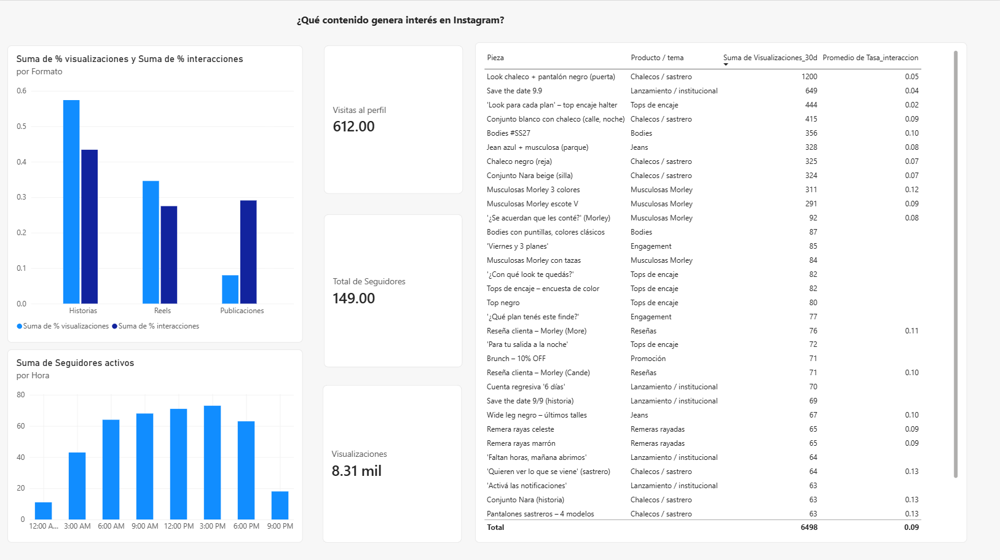
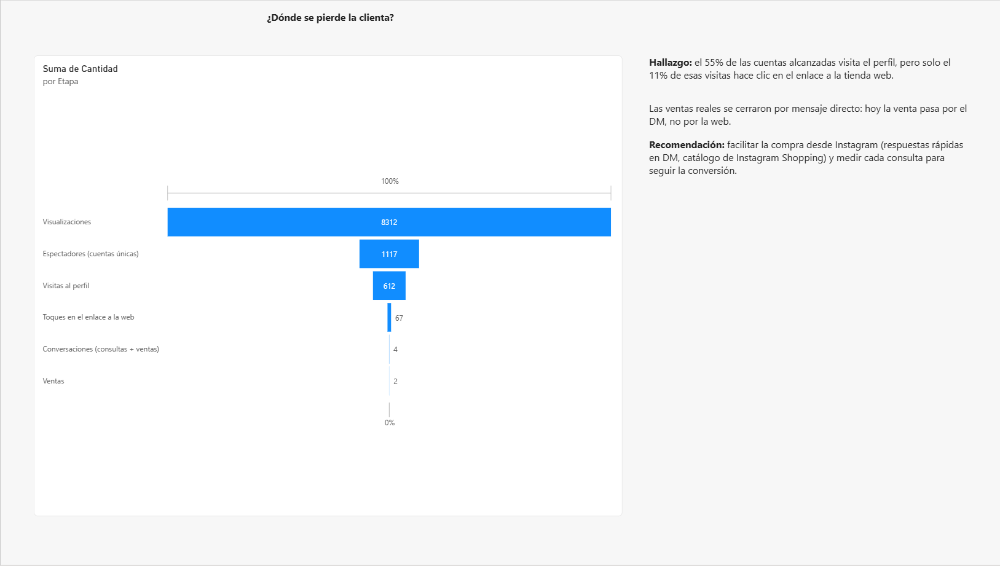
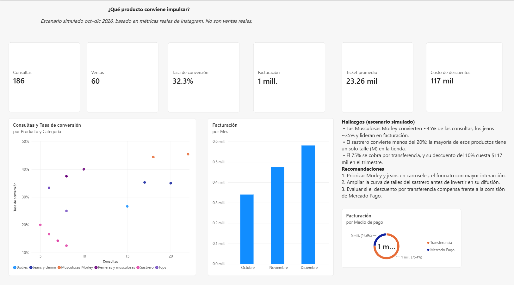

# Aranay: análisis comercial de una marca de ropa online

**Dashboard en Power BI** · Proyecto de portfolio de Business Analyst · Octubre 2026

Aranay es mi marca de ropa femenina online. Vende por Instagram y Tiendanube. Este proyecto analiza qué contenido genera interés, dónde se pierde la clienta en el camino hacia la compra y qué productos conviene impulsar.

> ⚠️ **Sobre los datos:** las métricas de Instagram, el catálogo y los precios son **reales**. Las ventas de octubre a diciembre de 2026 son un **escenario simulado**: la marca tiene muy pocas ventas registradas, así que modelé un escenario a partir de las métricas reales. Cada fila del dataset indica su origen (`Real` / `Simulado`).

---

## Preguntas de negocio

1. ¿Qué formato y qué contenido de Instagram generan más interés?
2. ¿En qué etapa del recorrido (alcance → perfil → web → venta) se pierden las clientas?
3. ¿Qué productos convierten mejor las consultas en ventas y cuáles conviene impulsar?

## Herramientas

- **Power BI** (Service): modelo de datos, medidas DAX y dashboard de 3 páginas
- **Excel**: limpieza y estructuración de los datos en tablas
- **Fuentes**: Panel profesional de Instagram (90 días) y catálogo de Tiendanube

---

## Dashboard

📄 **Dashboard completo en PDF:** [`aranay_dashboard.pdf`](aranay_dashboard.pdf)

### 1. Instagram: ¿qué contenido genera interés? *(datos reales)*

- **8.312 visualizaciones**, 612 visitas al perfil y 149 seguidores en 90 días.
- **Las publicaciones (carruseles) son el formato más eficiente:** tienen solo el 8% de las visualizaciones pero generan el 29% de las interacciones. En las historias pasa lo contrario: 57% de las visualizaciones y 43% de las interacciones.
- El look con chaleco sastrero fue la pieza más vista (1.200 visualizaciones), pero las **Musculosas Morley** tuvieron la mejor tasa de interacción (~12%).
- El público está activo de **9 a 18 h**, con pico a las 15 h.

### 2. Embudo: ¿dónde se pierde la clienta? *(datos reales)*

- El **55%** de las cuentas alcanzadas visita el perfil, pero solo el **11%** de esas visitas hace clic en el enlace a la tienda web.
- Las ventas reales se cerraron por **mensaje directo y transferencia**, no por la web.

### 3. Escenario comercial: ¿qué producto conviene impulsar? *(datos simulados)*

| Categoría | Consultas | Ventas | Conversión | Facturación |
|---|---:|---:|---:|---:|
| Musculosas Morley | 40 | 18 | **45%** | $272.636 |
| Remeras y musculosas | 26 | 10 | 38% | $147.540 |
| Jeans y denim | 45 | 16 | 36% | **$631.746** |
| Tops | 20 | 6 | 30% | $113.116 |
| Bodies | 15 | 4 | 27% | $69.174 |
| Sastrero | 40 | 6 | **15%** | $161.190 |
| **Total** | **186** | **60** | **32%** | **$1.395.402** |

- Las **Morley** tienen la mejor conversión; los **jeans** lideran en facturación por su precio.
- El **sastrero** genera tantas consultas como las Morley, pero convierte un tercio. Una posible causa, observada en el catálogo real: la mayoría de esos productos está cargada en **un solo talle (M)**.
- El 75% de la facturación se cobra por transferencia. El descuento del 10% por ese medio cuesta **$116.898** en el trimestre (7,7% de la facturación a precio de lista).

---

## Recomendaciones

1. **Priorizar Morley y jeans en carruseles**, el formato con mayor interacción, en el horario de 9 a 18 h.
2. **Ampliar la curva de talles del sastrero** antes de invertir más en su difusión.
3. **Facilitar la compra desde Instagram** (respuestas rápidas en DM, Instagram Shopping), porque la venta pasa por el DM y no por la web.
4. **Evaluar el descuento por transferencia** frente a la comisión de Mercado Pago.
5. **Registrar cada consulta y venta** para reemplazar el escenario simulado por datos reales.

---

## Datos y modelo

**Archivo:** [`aranay_instagram_metricas.xlsx`](aranay_instagram_metricas.xlsx)

| Tabla | Contenido | Origen |
|---|---|---|
| `tb_cuenta` | Métricas de la cuenta en 90 días | Real |
| `tb_formatos` | % de visualizaciones e interacciones por formato | Real |
| `tb_contenido` | 52 piezas de contenido con visualizaciones e interacciones | Real |
| `tb_horaria` | Seguidores activos por hora | Real |
| `tb_embudo` | Etapas del recorrido hasta la venta | Real |
| `tb_productos` | 18 productos con su precio de lista | Real (Tiendanube) |
| `tb_ventas_consultas` | 250 registros de consultas y ventas | 4 reales + 246 simulados |

**Supuestos de la simulación** (detallados en la hoja `Supuestos_simulacion`):
- Tasas de conversión por categoría basadas en la tasa de interacción real de cada producto en Instagram.
- Horarios ponderados según la actividad real de los seguidores.
- Precio: lista web; por transferencia, lista −10% (política real de la marca).
- Semilla aleatoria fija, para que el dataset sea reproducible.

**Medidas DAX:** ver [`medidas_dax.md`](medidas_dax.md).

---

## Próximos pasos

- Reemplazar el escenario simulado con ventas reales registradas.
- Replicar los cálculos en SQL.
- Medir el impacto de las recomendaciones en el próximo trimestre.

---

**Melisa Aragón** · Licenciatura en Administración de Empresas (UBA) · [LinkedIn](https://www.linkedin.com/in/melisa-aragon-596ba91b9/?isSelfProfile=true)
